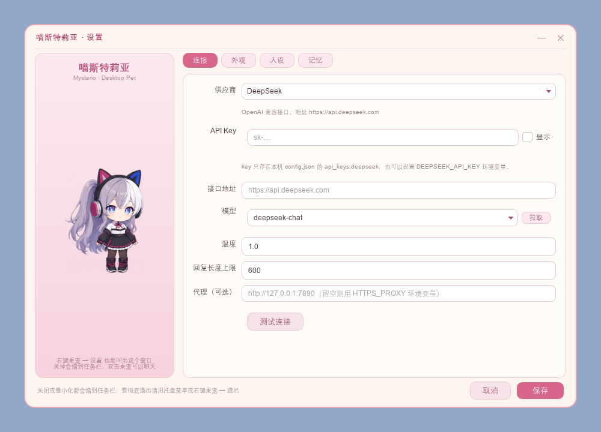

# 喵斯特莉亚 · 桌面宠物

一个 Windows 桌面宠物：6 张 512×512 立绘差分，透明无边框常驻桌面，可拖动、可缩放，接入大模型 API 后能流式对话。

支持三种接口，设置里随时切换，各自的 key 分别保存：

| 供应商 | 默认地址 | 默认模型 | 鉴权 |
| --- | --- | --- | --- |
| DeepSeek | `https://api.deepseek.com` | `deepseek-chat` | `Authorization: Bearer` |
| Google Gemini | `https://generativelanguage.googleapis.com` | `gemini-2.5-flash` | `x-goog-api-key` |
| 其他 OpenAI 兼容 | `https://api.openai.com/v1` | `gpt-4o-mini` | `Authorization: Bearer` |

Gemini 走原生 v1beta 接口（`models/{model}:streamGenerateContent?alt=sse`），系统提示词映射到 `systemInstruction`，助手消息映射为 `model` 角色；不是套一层兼容层。


## 快速开始

```powershell
cd 项目目录
pip install -r requirements.txt
python main.py
```

也可以直接双击 `run.bat`（用 `pythonw` 启动，不带控制台窗口）。

需要 Python 3.10+，依赖只有两个：`PyQt6` 和 `httpx`。

## 显示尺寸与 DPI

素材原图是 **512×512**，程序默认按 **256×256 逻辑像素**显示，`config.json` 里 `pet.size = 256`。

在 200% 缩放的屏幕上，256 逻辑像素 = **512 物理像素**，正好和素材 1:1，**没有任何重采样损失**——这就是"显示尺寸减半、但不压缩原图"的实现方式。100% 缩放的屏幕上是直接降采样到 256。

- 滚轮在桌宠上滚动即可连续缩放（64~768），松手就记住。
- 右键 → 尺寸：128/192/256/320/384/512 预设、自定义逻辑像素、按物理像素设置、恢复默认。
- 尺寸选 `128（逻辑）` 时物理是 256px，如果你想要"屏幕上真的只有 256 个物理像素"，选这个。

程序只按「逻辑尺寸 × 屏幕缩放」生成设备像素副本，源文件永远不动。

## 交互

| 操作 | 效果 |
| --- | --- |
| 左键拖动 | 移动，位置自动记住 |
| 单击 | 戳她一下，随机开心或惊讶 |
| 双击 / 托盘双击 | 打开或收起对话气泡 |
| 滚轮 | 缩放 |
| 右键 | 尺寸、置顶、设置、隐藏到托盘、退出 |
| 托盘图标 | 显示桌宠、聊天、设置、退出 |
| 任务栏图标 | 只在设置窗口打开时出现；最小化时保留，关闭时消失 |

## 设置窗口

启动时**不创建也不显示**设置窗口，桌面上只有桌宠和托盘图标。需要设置时：右键桌宠 → 设置，或托盘菜单 → 设置。

窗口出现后才有任务栏图标，三种收起方式的区别：

| 操作 | 窗口 | 任务栏图标 |
| --- | --- | --- |
| 「—」最小化 | 缩到任务栏 | **保留**，点它还原 |
| 「✕」/ Esc | 隐藏 | **消失**，桌宠和托盘继续运行 |
| 保存 / 取消 | 隐藏 | **消失** |

首次打开会居中显示，之后记住位置。彻底退出请用托盘菜单或右键桌宠 → 退出。

界面参考了原作视觉小说里的粉白卡片风格：左侧人物立绘，右侧分页签（连接 / 外观 / 人设 / 记忆），奶白底 + 粉色描边，配色和桌宠素材一致。



## 表情是自动触发的

平时就是**待机**，其余五张由具体场景触发：

| 立绘 | 触发条件 | 持续 |
| --- | --- | --- |
| 待机 `idle` | 默认状态；任何临时表情结束后回到这里 | 常态 |
| 思考 `thinking` | 消息已发出、还没收到第一个字 | 到首字到达 |
| 工作 `working` | 正在流式收字（像在敲键盘写回复） | 到回复结束 |
| 开心招手 `happy` | 回复成功、被戳、刚打开对话框 | 约 1.2~1.8 秒 |
| 惊讶 `surprised` | 接口报错、没配 key、被戳 | 约 1.4~1.8 秒 |
| 休息 `resting` | 连续无操作超过设定时长（默认 180 秒） | 到下次交互 |

优先级是 **短暂反应 > 对话忙碌态 > 待机/休息**，所以就算她正在"打字"，戳一下也会立刻给你反应，之后自动接回原来的状态。

拖鼠标、滚轮、点她、开对话、改设置都会重置休息计时；休息中任何操作都会把她叫醒。

## 接入大模型

1. 右键桌宠 → **设置** → **连接** 页，先选供应商，再填 `API Key`，点 **测试连接** 确认可用，保存。
2. 模型名可以直接下拉选；不确定当前 key 能用哪些模型时点 **拉取**，会列出账号下可对话的模型。
3. 也可以用环境变量（优先于配置文件）：

```powershell
[Environment]::SetEnvironmentVariable("DEEPSEEK_API_KEY", "sk-你的key", "User")
[Environment]::SetEnvironmentVariable("GEMINI_API_KEY", "AIza你的key", "User")
```

各家 key 分开存在本机 `config.json` 的 `api_keys` 里，切换供应商不会互相覆盖；请求只发往你选的那家的地址。

设置页里还能改：接口地址（可指向中转站或本地 Ollama）、模型、温度、回复长度上限、**代理**（留空则读 `HTTPS_PROXY`）、**多久无操作后休息**，以及**人设提示词**（决定她的性格和说话方式，可一键恢复默认）。

没配 key 时点发送会直接在气泡里提示，不会静默失败；401/402/403/404/429/超时/断网都有对应的中文说明。Gemini 被安全策略拦截时会单独提示，而不是显示"她什么也没说"。

## 记忆

她会记住你们聊过的事，重启后还记得。记忆存在 `memory.json`：默认就在程序旁边（源码运行是项目目录，打包后是 exe 所在文件夹），所以把文件夹换个位置或换台电脑，记忆跟着走。

如果程序被放在不可写的位置（例如装进 `Program Files`、只读盘或网络共享），会自动改用 `%APPDATA%\Mysterio\`，设置 → 记忆里显示的始终是**实际生效**的路径。

**送进模型的不是全部历史**，而是「一段记忆摘要 + 最近对话」，总量受 token 预算约束（默认 2400，设置里可调）。超出预算时的处理：

1. 从最旧的一端**成对淘汰**（用户+助手一起走，避免上下文以助手消息开头）
2. 一次淘汰到预算的 **60%** 而不是刚好压线——留出余量，一次整理能撑十几轮，不至于每轮都重写摘要
3. **最近 6 条永不淘汰**（3 个来回），当前话题始终完整
4. 被淘汰的内容先折成本地摘录兜底，回复完成后**再异步交给模型压缩**：把「旧摘要 + 被淘汰的原文」重写成一段短记忆，优先保留称呼、偏好、约定和重要事实，丢掉寒暄

第 4 步是关键：纯按行截断会把最早的事实先挤掉，实测中"用户喜欢薄荷绿"会被一堆"今天天气不错"挤没；模型压缩后能稳定留住这类关键事实。压缩失败（断网、限流）就沿用本地摘录，不会让聊天卡住。

摘要本身也有上限（预算的 25%），所以极长的对话里最早的内容最终还是会淡出——这是有意的取舍：记忆是有限的，重要的是别把预算全花在"嗯嗯哈哈"上。

### 永久记忆（"一定要记住"）

滚动摘要会淡出，但**你明确交代过的事不会**。只有说出这类话时才会写入：

```
一定要记住：我养了一只叫豆豆的猫，是只橘猫
别忘了周五下午三点交报告
帮我记一下，我的车牌是沪A12345
记牢，我喜欢的颜色是薄荷绿
```

规则是保守的，宁可漏记也不乱记：

- 必须命中"一定要记住 / 别忘了 / 帮我记一下 / 记牢 / 保存下来"这类**祈使**说法
- **疑问句不记**："你还记得我的猫叫什么吗"只是在考她，不会写入
- 只留事实本身，触发词、语气词、标点会被去掉（"一定要记住：我最喜欢的颜色是薄荷绿" → "我最喜欢的颜色是薄荷绿"）
- 重复内容不重复记（忽略空格和标点比较）
- 上限 40 条，超了丢最旧的

永久记忆存在 `facts.json`，**每轮对话都会注入 system prompt，且不参与摘要淘汰**。设置 → 记忆里能看到清单，可以删单条或全清；对话里记下来时气泡会提示「（记住了：…）」。

关掉"启用记忆"后，既不会写也不会注入。

## 打包成免安装文件夹

```powershell
build_exe.bat
```

需要额外装打包依赖（脚本会自动检测并安装）：

```powershell
pip install -r requirements-dev.txt
```

产物是 `dist\MysterioPet\`（约 108 MB），把整个文件夹压缩发给别人即可，对方**不需要装 Python**，双击里面的 `MysterioPet.exe` 就能用。

打包后：

- 启动约 0.5 秒（onedir 不压缩成单文件，省掉每次解包的时间）
- 启动日志和报错写在 exe 旁边的 `pet.log`，出问题让对方发这个文件
- 配置写在 exe 旁边（不可写时退到 `%APPDATA%\Mysterio`），对方的 key 不会跟你混在同一个文件里
- 脚本已用 `--exclude-module` 剔掉 numpy / matplotlib / pandas 等用不到的库，否则包会大一倍
- 如果更想要单个 exe，把 `build_exe.bat` 里的 `--onedir` 换成 `--onefile`，代价是体积更小但每次启动慢 3 秒左右

> 两个打包坑已经踩过并写进脚本：`--add-data` 的源路径必须是绝对路径（否则会按 spec 目录解析）；conda 环境下必须把 `Library\bin` 放进 `PATH`，否则冻结版会缺 `pyexpat`、`libssl` 等 DLL，表现为「双击没反应」。

发出去的 exe 没有签名，Windows 可能弹 SmartScreen「未知发布者」，点「更多信息 → 仍要运行」即可。

## 项目结构

```
main.py                 入口：窗口 + 托盘 + 聊天编排
pet/config.py           配置读写、六态定义、默认人设
pet/behavior.py         表情状态机：待机/思考/工作/开心/惊讶/休息的触发规则
pet/sprites.py          精灵加载与 DPR 感知缩放缓存
pet/window.py           无边框透明窗口：拖动、戳一下、缩放、右键菜单
pet/bubble.py           对话气泡：聊天记录、流式插入、输入框
pet/providers.py        供应商适配：URL、鉴权头、请求体、增量文本、错误文案
pet/chat.py             对话客户端：SSE 解析、QThread worker、测试连接、拉模型、记忆压缩
pet/memory.py           对话记忆：落盘、token 预算、低水位淘汰、摘要与后台压缩
pet/facts.py            永久记忆：触发判定、事实提取、去重与注入
pet/settings.py         设置窗口（粉白主题、任务栏常驻、连接 / 外观 / 人设 / 记忆）
miastria_chibi/poses/   6 张 512×512 立绘（frames/ 与 source/ 见该目录 README）
docs/                   README 用的截图
tools/pet_smoke.py      离屏冒烟测试
build_exe.bat           打包脚本（生成 dist\MysterioPet\）
requirements.txt        运行依赖（PyQt6、httpx）
requirements-dev.txt    打包依赖（PyInstaller、Pillow）
```

运行时生成、**不要提交**的文件（已在 `.gitignore` 里）：`config.json`（含 API Key）、`memory.json`、`facts.json`、`pet.log`、`build/`、`dist/`。

## 自测

```powershell
python tools/pet_smoke.py
```

离屏跑 125 项断言（渲染、缩放夹紧、表情触发与回退、休息与唤醒、气泡跟随、SSE 解析、DeepSeek / Gemini 两套请求体与鉴权、旧配置迁移、代理生效、模型列表过滤、错误文案，记忆的落盘、预算淘汰、低水位、最近 6 条保护、摘要注入、模型压缩、失败回滚，永久记忆的触发与提取，以及设置窗口的创建时机、最小化 / 关闭 / 保存三种收起方式、首次居中与位置记忆，配置/记忆路径的解析与只读回退）。不联网，也不会动真实 `config.json` / `memory.json`，截图和报告写到本地的 `build/smoke/`。

## 隐私与仓库

- 仓库里**不含任何 API Key**；key 只在你本机的 `config.json`（或环境变量）里
- `config.json`、`memory.json`、`facts.json`、`pet.log` 都在 `.gitignore` 中，对话内容和记忆不会被提交
- 首次运行会自动生成空白的 `config.json`，填入自己的 key 即可
- 素材里的角色属于原作，代码以 MIT 协议开源；如需商用或再分发立绘，请自行确认版权

## 已知情况

- **看不到宠物？** 先看是不是被别的常驻悬浮窗盖住了：默认位置在左下角，因为右下角常被这类窗口占用；拖动到别处即可，位置会记住。
- **截图里没有宠物？** `.NET CopyFromScreen` 这类截图方式抓不到 Qt 的分层透明窗口，用 Qt / 系统截图工具（Win+Shift+S）就能拍到。这不是显示问题。
- **libpng iCCP 警告**：素材 PNG 带的 sRGB 配置块不规范，Qt 会打两条警告，不影响显示。
- **没有动画**：6 张差分靠触发条件切换（见上表）。想再加眨眼/呼吸这类微动效，可以后续用定时器做轻微位移或补几帧。
- **Gemini 连不上**：`Gemini API` 在国内常常需要代理。设置 → 连接 → **代理** 填 `http://127.0.0.1:端口`，或设 `HTTPS_PROXY` 环境变量；DeepSeek 的域名一般可以直连。
- **Gemini 模型名会变**：Google 出了新模型后，点设置里的 **拉取** 直接选账号可用的，不用手猜名字。
